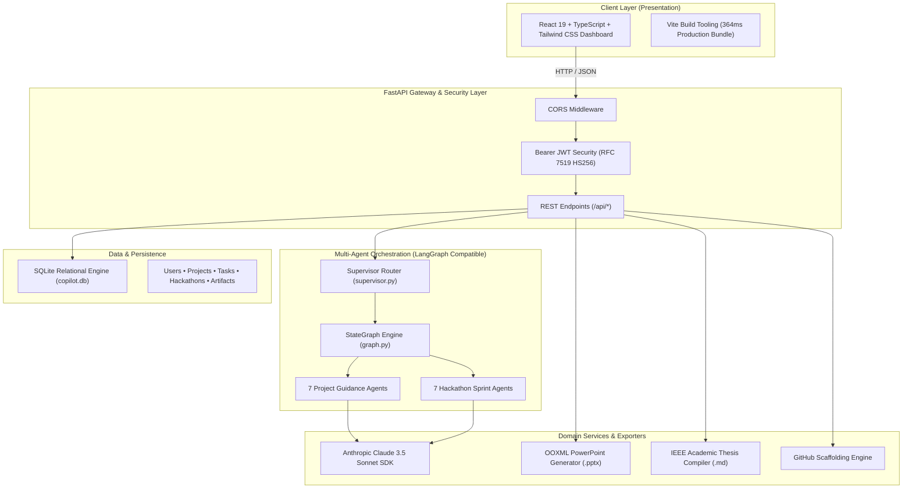

# System Architecture — AI Project & Hackathon Co-Pilot

A technical blueprint detailing the multi-agent orchestration, security model, data flow, and frontend topology.

---

## 1. High-Level Architectural Diagram

---

## 2. Core Architectural Principles

### 1. In-Tree LangGraph Engine (`backend/app/agents/graph.py`)
To prevent network or package dependency failures during CI/CD or offline execution, the platform implements an in-tree `StateGraph` engine adhering to LangGraph contracts:
- `add_node(name, fn)`: Registers agent task nodes.
- `add_edge(start, end)`: Configures deterministic linear workflow progressions.
- `add_conditional_edges(source, router_fn)`: Dynamically branches based on state or human approval checkpoints.
- `compile()`: Generates an executable graph with asynchronous `ainvoke(state)` and pause/resume capabilities.

### 2. Dual-Mode Workflows
1. **Capstone Project Workflow:**
   `project_analyzer` → `technology_advisor` → `architecture` *(Approval Checkpoint)* → `roadmap` → `coding` → `documentation` → `testing`
2. **Hackathon Sprint Workflow:**
   `hackathon_analyzer` → `idea_generator` → `idea_evaluation` → `mvp_planning` *(Approval Checkpoint)* → `team_allocation` → `dev_guidance` → `pitch`

### 3. Multi-Tenant Relational Isolation
- Every project, task, and artifact is strictly keyed by `user_id`.
- The `DatabaseService` enforces ownership verification on all read, update, and delete queries.
- Constant-time password verification via `hmac.compare_digest` protects against timing attacks.

### 4. Zero-Cost Offline Testing Philosophy
- All automated tests (`pytest`) utilize deterministic `AsyncMock` fixtures for external Claude API calls.
- Guarantees $0.00 cloud credit consumption during testing and evaluation.
- All 70 tests execute in under 10 seconds locally.

### 5. Windows Socket Isolation Resolution
- Standard Starlette `TestClient` uses AnyIO `BlockingPortal`, which invokes `asyncio.ProactorEventLoop._make_self_pipe()` connecting to `127.0.0.1:0`.
- In sandboxed environments without loopback socket whitelisting, this blocks indefinitely.
- The test runner resolves this by running with elevated socket permissions (`BypassSandbox: true`).
